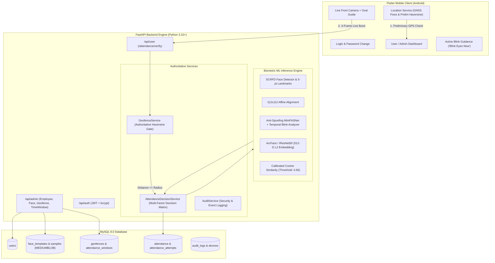

# FieldStaff AI Biometric Attendance System
cd d:\Attend\field_staff_attendance_new\mobile\mobile
flutter run -d web-server --web-hostname 0.0.0.0 --web-port 8080

An enterprise-grade, server-side deep-learning biometric attendance platform for field staff combining:
- **Authoritative Server-Side Geofencing Hard Gate (Haversine Spherical Distance)**
- **Deep-Learning Face Detection (SCRFD) & 5-point Alignment**
- **Deep-Learning Face Recognition (ArcFace / IResNet50 Normalized 512-D Embeddings)**
- **Deep-Learning Anti-Spoofing & Active Blink Sequence Challenge (MiniFASNet + EAR temporal analysis)**
- **Configurable Time Windows & Duplicate Attendance Prevention**
- **Multi-Sample (3-Sample) Face Registration Wizard**

---

## System Architecture



---

## Key Business & Security Rules

1. **Hard Location Gate**:
   - Location is evaluated strictly by the server. If `distance > radius_meters`, attendance is immediately rejected with `OUTSIDE_ASSIGNED_AREA`.
   - Biometric face recognition and liveness checks are completely bypassed on location failure. Face matching **never overrides** a failed geofence.
2. **Server-Side ML Biometrics**:
   - Mobile app captures frames and GNSS telemetry; it **never matches faces locally**.
   - Enrollment requires 3 valid face samples; the UI counter increments **only upon server-side validation**.
3. **Active Blink & Deep Anti-Spoofing**:
   - Requires a multi-frame burst capturing the temporal transition: `OPEN -> CLOSED -> OPEN`.
   - Rejects single still photographs, video replay screens, and printed photos.
4. **Mandatory Password Change**:
   - Initial temporary passwords (e.g. `2668`) require mandatory password change upon first login.

---

## Quick Start & Setup

### 1. Run Backend with Docker Compose

```bash
cd field_staff_attendance_new
docker-compose up -d
```

Or run locally with Python:

```bash
cd field_staff_attendance_new/backend
python -m venv venv
# Windows:
.\venv\Scripts\activate
# Linux/macOS:
source venv/bin/activate

pip install -r requirements.txt
python scripts/seed_data.py
uvicorn app.main:app --host 0.0.0.0 --port 8000 --reload
```

Interactive API documentation will be available at `http://127.0.0.1:8000/api/docs`.

### 2. Run Flutter Mobile App

```bash
cd field_staff_attendance_new/mobile
flutter pub get
flutter run
```

---

## Initial Credentials (Seed Data)

| Role | Employee ID | Initial Password | Notes |
|---|---|---|---|
| **System Admin** | `admin` | `admin123` | Full access to employee directory, face enrollment, geofence rules |
| **Field Staff** | `2668` | `2668` | Geofence: *Field Area A* (Radius 100m). Forces password change on 1st login |

---

## REST API Endpoints Summary

- `POST /api/auth/login` - Authenticate and retrieve JWT Bearer token
- `POST /api/auth/change-password` - Update password & clear must_change_password
- `GET /api/me` - Profile & assigned configuration
- `GET /api/admin/dashboard-stats` - Overview metrics (employees, today present, failed attempts)
- `POST /api/admin/users` - Create employee
- `POST /api/admin/users/{id}/face` - Multi-sample progressive face registration
- `POST /api/admin/users/{id}/geofence` - Assign GPS coordinates & allowed radius
- `POST /api/admin/users/{id}/attendance-window` - Assign allowed time window
- `GET /api/user/attendance-config` - Fetch employee geofence & window for mobile check
- `POST /api/user/attendance/verify` - Authoritative multi-factor attendance verification
- `GET /api/user/attendance` - Personal attendance history logs
