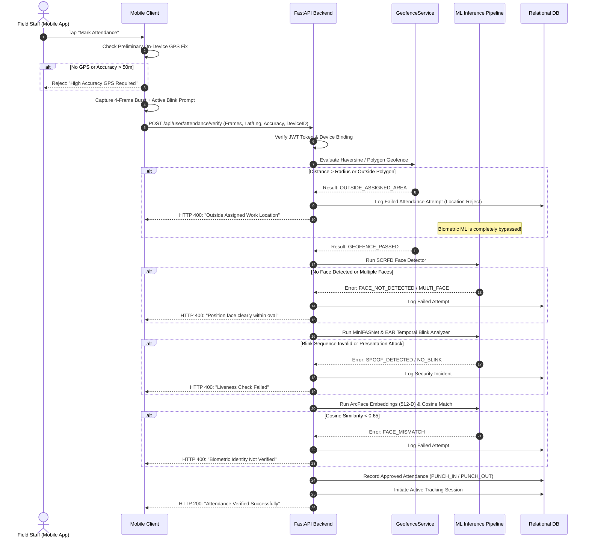

# FieldStaff AI Biometric Attendance & Field Staff Tracking Platform
## Document 01: System Overview & Comprehensive Architecture

---

### Executive Summary

The **FieldStaff AI Biometric Attendance and Field Staff Tracking System** is an enterprise-grade, distributed cyber-physical platform engineered for managing distributed field workforces, remote employees, and operational personnel across geographical areas. The platform combines **authoritative server-side geofencing**, **deep-learning facial recognition (SCRFD + ArcFace)**, **multi-frame active anti-spoofing and blink temporal analysis**, **continuous background GPS journey tracking with route simplification (Ramer-Douglas-Peucker)**, **dynamic multi-shift rule engines**, and **real-time management portals (React Web & Electron Desktop Time Office)**.

Unlike naive attendance platforms that rely on client-side verification or simple biometric heuristics easily spoofed by simulated GPS or photographic replay attacks, this platform enforces a **Zero-Trust Client** security model:
1. **The mobile client is strictly an untrusted sensor aggregator**: All decisions (geofencing boundaries, time windows, liveness, and identity matching) are made authoritatively by the backend server.
2. **Hard-gated location evaluation**: Biometric inference is skipped entirely if the user is outside the authorized geographic boundary, eliminating wasted compute and preventing out-of-bounds spoofing.
3. **Temporal liveness verification**: Active blink sequence evaluation prevents static photo presentation, high-resolution screen replays, and cut-out mask attacks.
4. **Resilient offline-first telemetry**: Field workers operating in cellular dead-zones can log cryptographically timestamped punches and store compressed GPS breadcrumbs locally for deferred synchronization.

---

### End-to-End System Topology

```mermaid
graph TB
    subgraph Mobile_Tier ["Field Staff Mobile Tier (Flutter Android Client)"]
        UI_AUTH["Authentication & Forced Password Change"]
        UI_VERIFY["Biometric Verification Screen (Oval HUD + Live Blink Prompts)"]
        UI_DASH["User Dashboard (Shift Timers, Status, Geofence Distance)"]
        UI_REQ["Attendance Regularization & Manual Request Screen"]
        TRACK_SVC["Native Background Tracking (Foreground Service + WakeLocks)"]
        OFFLINE_DB[("Local SQLite Cache: Breadcrumbs & Offline Punches")]
        PATCH_HUD["Free Fire Patch HUD (Dynamic Hot-Patch & OTA APK Engine)"]
    end

    subgraph Time_Office_Tier ["Management & Operations Tier (React 18 + Vite / Electron Desktop)"]
        WEB_DASH["Time Office Executive Dashboard"]
        DAILY_REG["Daily & Monthly Attendance Registers"]
        LIVE_MAP["Real-Time Multi-Agent Live Tracking Map (Leaflet / OSM)"]
        ROUTE_REPLAY["Historical Journey Replay with Playback Slider"]
        EMP_MGR["Employee Master & Multi-Sample Face Enrollment Wizard"]
        POLICY_CFG["Shift & Regularization Policy Configurator"]
    end

    subgraph Backend_Tier ["FastAPI Core Processing Engine (Python 3.10+)"]
        API_GATEWAY["FastAPI API Gateway & SlowAPI Rate Limiter"]
        AUTH_ROLES["JWT Auth, RBAC & Device Fingerprint Middleware"]
        
        subgraph Authoritative_Services ["Authoritative Core Services"]
            DECISION_SVC["AttendanceDecisionService (Multi-Factor Rule Engine)"]
            GEO_SVC["GeofenceService (Spherical Haversine & Ray-Casting Polygon)"]
            SHIFT_SVC["ShiftEngineService (Grace, Penalty, OT & Night-Shift Logic)"]
            SCHEDULER_SVC["ShiftTrackingSchedulerService (Background Reconciliation Loop)"]
            ROUTE_SVC["RouteSimplificationService (Ramer-Douglas-Peucker)"]
            UPDATE_SVC["AppUpdateService (OTA Binary Stream & Version Control)"]
        end

        subgraph ML_Biometric_Pipeline ["Biometric ML Inference Engine"]
            SCRFD["SCRFD Deep-Learning Face Detector (5 Landmark Points)"]
            AFFINE["112x112 Affine Transform Alignment"]
            LIVENESS["MiniFASNet Anti-Spoofing & EAR Temporal Blink Analyzer"]
            ARCFACE["ArcFace / IResNet50 Deep Residual Embedding Engine (512-D)"]
            COSINE["Calibrated Cosine Metric Comparator (Threshold: 0.65)"]
        end
    end

    subgraph Persistence_Tier ["Hybrid Persistence & Storage Layer"]
        DB_RELATIONAL[("PostgreSQL / MySQL / SQLite: Users, Attendance, Shifts, Geofences")]
        DB_TIMESERIES[("TimescaleDB Hypertables: High-Throughput GPS Breadcrumbs")]
        BLOB_STORE[("Filesystem / Storage: Face Samples, Crop Evidence, APK Binaries")]
    end

    %% Inter-component Communications
    UI_AUTH -->|"HTTPS / POST /api/auth/login"| API_GATEWAY
    UI_VERIFY -->|"Burst Frames + GNSS Telemetry"| API_GATEWAY
    TRACK_SVC -->|"Periodic Compressed GPS Batches"| API_GATEWAY
    PATCH_HUD -->|"Version Check & Chunked Stream"| API_GATEWAY
    
    WEB_DASH -->|"REST /api/time-office/*"| API_GATEWAY
    LIVE_MAP -->|"Live Tracking & Playback Queries"| API_GATEWAY
    EMP_MGR -->|"3-Sample Enrollment Pipeline"| API_GATEWAY

    API_GATEWAY --> AUTH_ROLES
    AUTH_ROLES --> DECISION_SVC
    AUTH_ROLES --> GEO_SVC
    AUTH_ROLES --> SHIFT_SVC
    AUTH_ROLES --> ROUTE_SVC
    AUTH_ROLES --> UPDATE_SVC

    DECISION_SVC --> GEO_SVC
    GEO_SVC -->|"Pass Hard Gate"| ML_Biometric_Pipeline
    ML_Biometric_Pipeline --> DECISION_SVC
    DECISION_SVC --> DB_RELATIONAL
    SCHEDULER_SVC --> DB_RELATIONAL
    ROUTE_SVC --> DB_TIMESERIES
    UPDATE_SVC --> BLOB_STORE
```



---

### Core Subsystems Directory Structure

```
d:\Attend\Backup\
├── backend/                  # FastAPI Application Engine & ML Biometrics
│   ├── app/
│   │   ├── api/              # REST Endpoints (auth, user, admin, tracking, shift, time_office)
│   │   ├── ml/               # SCRFD, ArcFace, MiniFASNet, EAR Blink, Alignment
│   │   ├── models/           # SQLAlchemy ORM Data Models (User, Attendance, Shift, Tracking)
│   │   ├── schemas/          # Pydantic Request/Response Validation Contracts
│   │   ├── security/         # JWT, Passwords, RBAC, Rate Limiting
│   │   ├── services/         # Decision Engine, Geofence, Shift, Scheduling, Simplification
│   │   └── utils/            # IP utilities, Time converters, Geo-math helpers
│   ├── weights/              # Pretrained ONNX Models (SCRFD, ArcFace, MiniFASNet)
│   └── timescaledb_setup.sql # Hypertables, Spatial Indexes, Chunk Partitioning
├── mobile/mobile/            # Flutter Cross-Platform Client (Android Primary)
│   ├── lib/
│   │   ├── config/           # App Constants, Palette, Server Endpoints
│   │   ├── core/services/    # Background Tracking, SQLite DB, Location, Offline Sync, Patch
│   │   ├── models/           # Dart Data Models (Punches, Tracking, Shifts, User Profile)
│   │   ├── screens/          # User Dashboard, Verify Attendance, Request, History, Admin
│   │   └── widgets/update/   # Free Fire Patch HUD, Oval Camera Overlay, Sensor Indicators
│   └── android/              # Native Android Manifest, Foreground Services, Gradle
├── time_office/              # React 18 + Vite Web Application Portal
│   ├── src/
│   │   ├── api/              # Axios Client & Time Office API Endpoints
│   │   ├── components/       # Common Nav, Route Sliders, Metric Cards, Modals
│   │   ├── context/          # Auth Context, Settings State, Shift Context
│   │   └── pages/            # Live Tracking Map, Registers, Employees, Leaves, Audit
├── time_office_desktop/      # Electron Desktop Distribution of Time Office
│   ├── electron/             # Main process, IPC Handlers, Tray, Hardware acceleration
│   └── src/                  # React/Vite UI bundle for desktop packaging
└── Mapping/                  # Standalone GPS Journey Tracker & Polygon Survey App
    └── lib/main.dart         # Field Boundary Mapping & Polygon Coordinate Capture
```

---

### High-Level Subsystem Breakdown

#### 1. Mobile Client (Flutter)
- **Role**: Field staff on-device operations, biometric capture, and native background location telemetry.
- **Key Capabilities**:
  - Front camera capture with custom oval guide, face centering feedback, and real-time luminance monitoring.
  - Active visual blink guidance prompts instructing the user to blink at dynamic intervals during a 4-frame burst.
  - Native Android Foreground Service with continuous wake lock, battery-conserving adaptive distance filtering, and local SQLite buffer (`tracking_database.dart`).
  - Free Fire inspired gaming-style Patch HUD (`free_fire_patch_hud.dart`) providing dynamic hot-patching, chunked APK downloading with animated progress bars, and hash validation.

#### 2. Backend Engine (FastAPI)
- **Role**: Authoritative brain, identity validator, spatial analyzer, and rule arbiter.
- **Key Capabilities**:
  - High-performance asynchronous API utilizing Python 3.10+ `asyncio` and `uvicorn`.
  - Machine learning runtime executing ONNX runtime models with CPU/CUDA execution providers.
  - Server-side time enforcement using synchronized server clock timestamps, completely neutralizing device clock manipulation.
  - Shift Tracking Scheduler running as an asynchronous daemon, continuously reconciling open tracking sessions, checking shift end boundaries, and closing overdue punches.

#### 3. Time Office Management Suite (Web & Desktop)
- **Role**: HR managers, shift supervisors, and operational controllers portal.
- **Key Capabilities**:
  - Live spatial tracking view rendering multi-employee markers on OpenStreetMap tiles with status indicators (Moving, Idle, Stationary, Offline).
  - Historical route replay featuring speed controls, milestone stops, stationary duration markers, and total distance traveled metrics.
  - Shift planning engine allowing creation of flexible shifts, split shifts, grace periods, half-day deduction rules, and automated late penalties.
  - Comprehensive reporting hub with CSV, Excel, and PDF export capabilities for payroll integration.

#### 4. Dedicated Mapping App
- **Role**: Surveying and bounding work zones.
- **Key Capabilities**:
  - Mobile tool for field managers to physically walk perimeter boundaries and collect high-precision polygon vertices.
  - Uploads GeoJSON polygon coordinates to the backend to establish authorized geofence zones.

---

### Zero-Trust Attendance Verification Flow



---

### Architectural Design Principles

1. **Server Authority Principle**: Never trust client claims regarding location, time, or biometric match. The client sends raw sensory artifacts (lat/lng/accuracy telemetry and camera frames); the backend extracts features, matches against stored mathematical templates, checks geographic bounds, and assigns the punch timestamp.
2. **Compute Conservation Principle**: Deep neural networks for face recognition (ArcFace) and anti-spoofing (MiniFASNet) consume significant CPU/GPU resources. By placing the pure-math spherical Haversine location gate first, requests originating outside work zones are rejected in under 2 milliseconds, conserving ML compute for valid punches.
3. **Defense-in-Depth Biometrics**: Single-frame biometrics are obsolete against modern mobile displays and printouts. The platform pairs deep static texture analysis (MiniFASNet) with temporal eye-state analysis across sequential frames (`OPEN -> CLOSED -> OPEN`), verifying real human physiological responses.
4. **Resilient Data Transmission**: Field mobile connections fluctuate. Telemetry uses compressed binary or JSON formats, local SQLite buffers, and exponential-backoff sync loops to ensure zero data loss during network outages.

---

### Cross-System Communication Protocols

| Channel | Source | Destination | Protocol / Payload | Security |
|---|---|---|---|---|
| User Authentication | Flutter Mobile | Backend `/api/auth/login` | HTTPS REST (JSON) | TLS 1.3, bcrypt, JWT Bearer Token |
| Attendance Punch | Flutter Mobile | Backend `/api/user/attendance/verify` | HTTPS Multipart / Base64 JSON | JWT, SHA-256 Frame Digest, Hard Geofence Gate |
| Live GPS Telemetry | Flutter Mobile | Backend `/api/tracking/ping` | HTTPS REST (Batch JSON) | JWT, Monotonic Sequence IDs, Battery Status |
| Time Office Admin | React / Electron | Backend `/api/time-office/*` | HTTPS REST (JSON) | Admin JWT, Role-Based Access Control |
| OTA Patch Distribution | Flutter Mobile | Backend `/api/app-update/check` | HTTPS REST / Chunked Binary | SHA-256 Checksums, Version Semver |

---
*Proceed to [Document 02: AI Biometric Pipeline & Liveness](file:///d:/Attend/Backup/docs/02_AI_BIOMETRIC_PIPELINE_AND_LIVENESS.md) for deep technical specifications of SCRFD, ArcFace, and MiniFASNet.*
