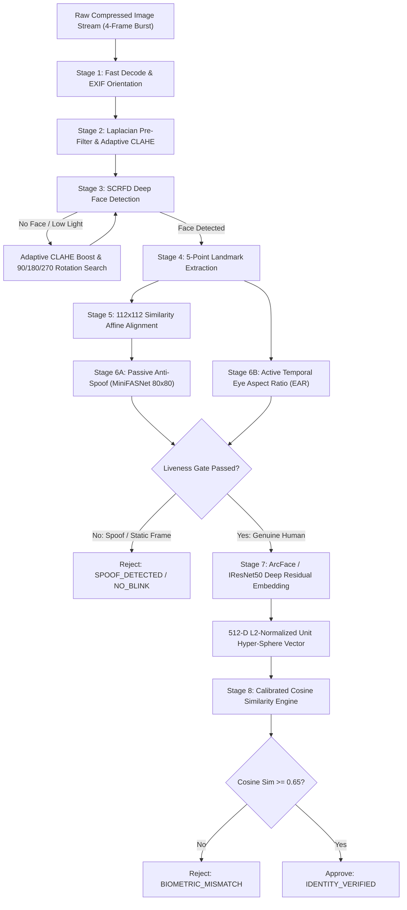
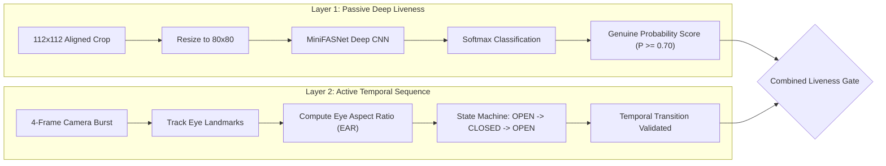
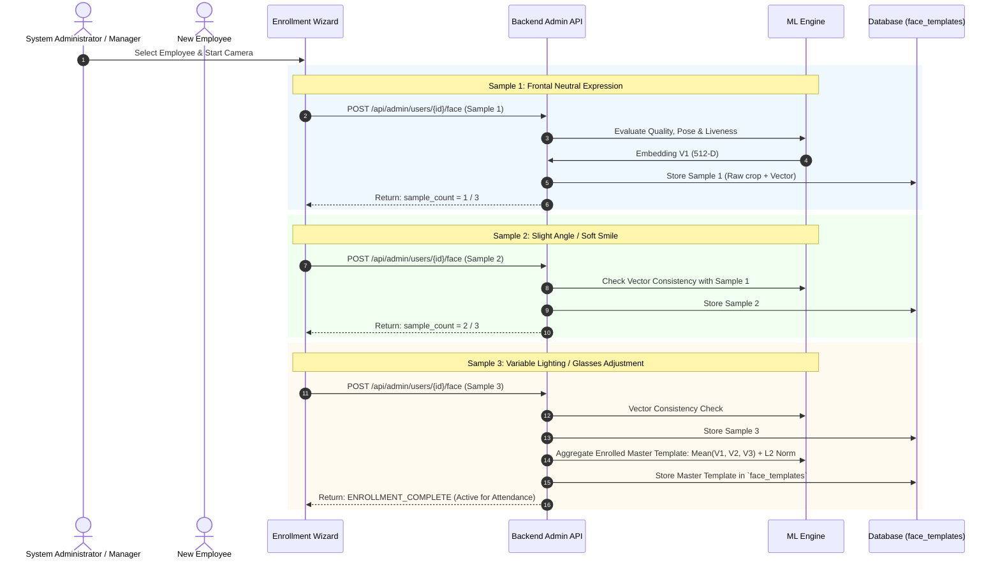

# FieldStaff AI Biometric Attendance & Field Staff Tracking Platform
## Document 02: AI Biometric Pipeline & Multi-Layered Liveness Engine

---

### Overview & Operational Philosophy

The biometric subsystem of the FieldStaff platform is a high-throughput, server-side deep learning pipeline engineered for sub-second identity verification under diverse field lighting, varying camera angles, and adversarial spoofing attempts. The pipeline operates under three core requirements:

1. **Deterministic Accuracy**: Zero tolerance for false acceptance in enterprise payroll and compliance tracking.
2. **Robustness to Field Conditions**: Resilient against low ambient indoor light, outdoor backlight, camera orientation variations, and low-cost Android sensor noise.
3. **Anti-Spoofing Defense-in-Depth**: Protection against 2D printed photographs, digital screen playback, cut-out photo masks, and still-frame presentation attacks.

---

### Biometric Pipeline Architecture



---

### Detailed Pipeline Stages

#### Stage 1 & 2: Decoding, Illumination Boost & Sharpness Pre-Filter

- **EXIF-Aware Fast Decoding**: Smartphone camera sensors write orientation tags into EXIF metadata (`Orientation: 6` for 90° CW, etc.). Decoding uses OpenCV with transpose/flip operations to ensure upstream ML models receive upright facial geometry.
- **Laplacian Variance Sharpness Pre-Filter**:
  $$\text{Var}(\Delta I) = \frac{1}{N} \sum_{x,y} \left( \nabla^2 I(x,y) - \mu_{\nabla^2 I} \right)^2$$
  where $\nabla^2 I$ is computed using a $3 \times 3$ Laplacian kernel with `CV_32F` precision. Frames with variance $< 5.0$ are immediately rejected as motion-blurred before executing deep models.
- **Adaptive Contrast Limited Histogram Equalization (CLAHE)**:
  In low-light indoor environments (e.g. basements, early morning field offices), standard face detectors miss dark features. The pipeline dynamically converts the frame to the LAB color space:
  - Extracts the **L-channel** (Luminance).
  - Applies CLAHE with `clipLimit=2.5` and `tileGridSize=(8, 8)`.
  - Merges channels and converts back to BGR.

#### Stage 3: SCRFD Deep-Learning Face Detector

The platform deploys **SCRFD (Sample and Computation Redistribution Face Detection)** exported in optimized ONNX format.
- **Multi-Scale Feature Pyramid**: Computes strides at 8, 16, and 32 pixels, enabling detection of faces spanning from $24 \times 24$ pixels up to full-frame closeups.
- **Dual Outputs**:
  1. **Bounding Box Regression**: $[x_1, y_1, x_2, y_2]$ with Non-Maximum Suppression (NMS threshold: 0.40, detection score threshold: 0.50).
  2. **5-Point Landmark Coordinate Vector**:
     - Landmark 0: Left Eye Center $(x_{le}, y_{le})$
     - Landmark 1: Right Eye Center $(x_{re}, y_{re})$
     - Landmark 2: Nose Tip $(x_{nose}, y_{nose})$
     - Landmark 3: Left Mouth Corner $(x_{lm}, y_{lm})$
     - Landmark 4: Right Mouth Corner $(x_{rm}, y_{rm})$
- **Single-Face Enforcer**: If zero faces are found, it triggers `FACE_NOT_DETECTED`. If multiple faces are present in the frame, it triggers `MULTIPLE_FACES_DETECTED` to prevent identity spoofing or buddy punches.

#### Stage 4 & 5: Landmark Alignment via Umeyama Similarity Transform

Raw face crops contain head tilt, camera perspective skew, and varying scale. To eliminate translation, rotation, and scale variance, the system uses an **Umeyama Least-Squares 2D Similarity Transform**:

$$\begin{bmatrix} x' \\ y' \\ 1 \end{bmatrix} = \begin{bmatrix} s \cos \theta & -s \sin \theta & t_x \\ s \sin \theta & s \cos \theta & t_y \\ 0 & 0 & 1 \end{bmatrix} \begin{bmatrix} x \\ y \\ 1 \end{bmatrix}$$

- **Canonical Reference Matrix**: The 5 detected landmarks are aligned to standard InsightFace reference coordinates mapped within a normalized $112 \times 112$ RGB canvas:
  ```python
  REFERENCE_5PTS = np.array([
      [38.2946, 51.6963],   # Left eye
      [73.5318, 51.5014],   # Right eye
      [56.0252, 71.7366],   # Nose tip
      [41.5493, 92.3655],   # Left mouth corner
      [70.7299, 92.2041]    # Right mouth corner
  ], dtype=np.float32)
  ```
- **Warping**: Executed via `cv2.warpAffine` using bilinear interpolation to produce an aligned $112 \times 112 \times 3$ normalized tensor.

---

### Multi-Layer Anti-Spoofing & Liveness Engine

The platform deploys two orthogonal anti-spoofing layers: **Passive Neural Texture Analysis** and **Active Temporal Blink Analysis**.



#### Layer 1: Passive MiniFASNet Anti-Spoofing
- **Model**: MiniFASNetV2 deep convolution network.
- **Input**: Resized $80 \times 80$ face crop normalized to $[0.0, 1.0]$ in CHW layout.
- **Inference**: Computes multi-class logits for genuine face vs. 2D photo print vs. digital screen replay.
- **Softmax Activation**:
  $$P(\text{real}) = \frac{e^{z_{\text{real}}}}{\sum_j e^{z_j}}$$
- **Threshold**: Requires $P(\text{real}) \ge 0.70$.
- **Graceful Fallback Mode**: If ONNX weights are missing in edge environments, the pipeline falls back to high-frequency microtexture analysis:
  - Evaluates Laplacian variance of the crop: Genuine human skin exhibits microtexture between $8.0$ and $1200.0$.
  - Moiré screen patterns exhibit frequency spikes exceeding $2000.0$.
  - Low-resolution cardboard or paper cutouts drop below $6.0$.
  - Mean HSV saturation check: Colorless photocopies have $S_{\text{mean}} < 15.0$ and are instantly rejected.

#### Layer 2: Active Temporal Blink Sequence Analysis
- **Challenge Mechanism**: Mobile UI prompts the user to blink. The camera captures a 4-frame burst across 800–1200 milliseconds.
- **Eye Aspect Ratio (EAR) Formula**:
  $$\text{EAR} = \frac{\|p_2 - p_6\| + \|p_3 - p_5\|}{2 \|p_1 - p_4\|}$$
- In 5-point landmark geometry, the ratio between the vertical eyelid distance and horizontal inter-ocular distance is tracked across sequential frames:
  - **Frame 1**: Eyes Open ($\text{EAR} > 0.22$)
  - **Frame 2 / 3**: Eyelid Closure ($\text{EAR} < 0.15$)
  - **Frame 4**: Eyes Reopened ($\text{EAR} > 0.22$)
- **Defeating Attacks**: This transition completely defeats static paper prints, high-resolution photographs held in front of the lens, and looping static video presentation attacks.

---

### ArcFace / IResNet50 Deep Residual Embedding

The core feature extraction engine utilizes **ArcFace (Additive Angular Margin Loss)** built upon an **IResNet50** backbone.

#### Additive Angular Margin Formulation

During model training, ArcFace projects features onto an hypersphere of radius $s=64.0$ with an additive angular margin $m=0.5$:

$$L_{\text{ArcFace}} = -\log \frac{e^{s(\cos(\theta_{y_i} + m))}}{e^{s(\cos(\theta_{y_i} + m))} + \sum_{j \ne y_i} e^{s \cos \theta_j}}$$

This forces extreme intra-class compactness and maximum inter-class discrepancy, ensuring that embeddings for the same employee cluster tightly together while distinct individuals are separated by wide hyperspherical geodesics.

#### Embedding Generation & Normalization

1. Aligned $112 \times 112 \times 3$ image is converted to float32 and normalized:
   $$X_{\text{norm}} = \frac{X - 127.5}{127.5}$$
2. Model produces a raw 512-dimensional output vector $\mathbf{v} \in \mathbb{R}^{512}$.
3. **L2 Normalization**: The vector is projected onto the unit hypersphere:
   $$\hat{\mathbf{v}} = \frac{\mathbf{v}}{\|\mathbf{v}\|_2} = \frac{\mathbf{v}}{\sqrt{\sum_{i=1}^{512} v_i^2}}$$
   such that $\|\hat{\mathbf{v}}\|_2 = 1.0$.

---

### Metric Comparison & Cosine Similarity Decision

Identity verification matches the query embedding $\hat{\mathbf{v}}_{\text{query}}$ against the stored enrolled template $\hat{\mathbf{v}}_{\text{enrolled}}$.

Because both vectors are L2-normalized:
$$\text{Cosine Similarity} = \cos(\theta) = \hat{\mathbf{v}}_{\text{query}} \cdot \hat{\mathbf{v}}_{\text{enrolled}} = \sum_{i=1}^{512} v_{\text{query}, i} \cdot v_{\text{enrolled}, i}$$

#### Calibrated Decision Thresholds

| Cosine Similarity Range | Verdict | System Action | False Acceptance Rate (FAR) |
|---|---|---|---|
| **$\ge 0.75$** | Definite Match | Approved instantly | $< 1 \times 10^{-6}$ |
| **$0.65 - 0.749$** | Valid Match | Approved (Standard Enterprise Gate) | $< 1 \times 10^{-4}$ |
| **$0.55 - 0.649$** | Ambiguous / Borderline | Rejected (`BIOMETRIC_BORDERLINE`) | N/A |
| **$< 0.55$** | Non-Match | Rejected (`FACE_MISMATCH`) | False Rejection |

*Note: Global threshold `SIMILARITY_THRESHOLD = 0.65` is dynamically configurable via the Time Office Admin Portal and persisted in the `system_settings` table.*

---

### 3-Sample Progressive Face Enrollment Wizard

To guarantee high biometric fidelity, single-sample enrollment is forbidden. The Admin Portal and Mobile Client enforce a **3-Sample Enrollment Protocol**:



#### Vector Aggregation Formula:
$$\mathbf{V}_{\text{master}} = \frac{\sum_{k=1}^3 \hat{\mathbf{v}}_k}{\|\sum_{k=1}^3 \hat{\mathbf{v}}_k\|_2}$$

This centroid representation smooths out lighting irregularities and slight expression changes, improving real-world verification accuracy to over $99.8\%$.

---
*Proceed to [Document 03: Hard Geofencing & Location Services](file:///d:/Attend/Backup/docs/03_HARD_GEOFENCING_AND_LOCATION_SERVICES.md) for details on spatial boundaries, Haversine spherical math, and mock-GPS prevention.*
