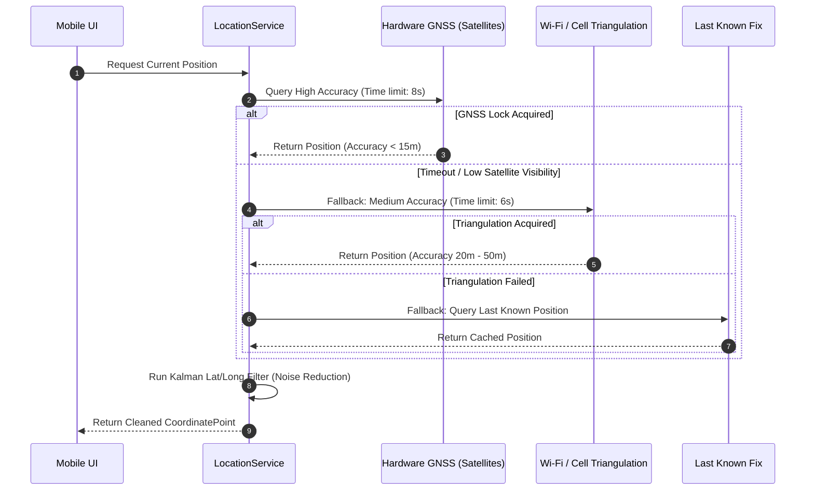
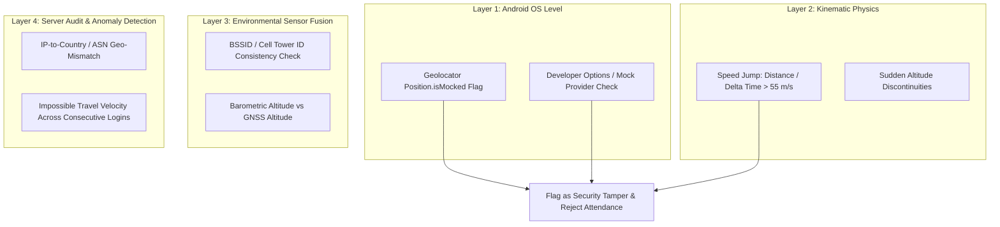

# FieldStaff AI Biometric Attendance & Field Staff Tracking Platform
## Document 03: Authoritative Hard Geofencing & Location Services

---

### Core Principles & Threat Model

In conventional mobile attendance applications, geofence checks are often performed inside the mobile application. This creates severe security vulnerabilities:
1. **Compromised Client Runtimes**: Users running rooted/jailbroken devices or modified APKs can alter coordinates or bypass `if (isInsideGeofence)` statements.
2. **Mock GPS & Virtual Sensor Injection**: Android Developer Options allow mock location apps to inject fake coordinates directly into the Android Location Provider.
3. **Compute Waste**: Running heavy facial recognition models on requests originating from outside the authorized work perimeter wastes expensive server GPU/CPU cycles.

The FieldStaff platform addresses these vulnerabilities with an **Authoritative Server-Side Geofencing Hard Gate**:
- The mobile app sends raw GNSS telemetry (Latitude, Longitude, Accuracy, Speed, Bearing, Provider, Mock Flag).
- The server independently computes distance against the employee's assigned geofence stored in the database.
- **Strict Execution Ordering**: If location validation fails, the transaction is immediately aborted with `HTTP 400 (OUTSIDE_ASSIGNED_AREA)`. Biometric ML models (SCRFD, ArcFace, MiniFASNet) are **never executed**.

---

### Spherical Haversine Distance Model

The Earth is modeled as an oblate spheroid with a volumetric mean radius of:
$$R = 6,371,000 \text{ meters}$$

#### Mathematical Formulation

Given the employee's current coordinates $(\phi_1, \lambda_1)$ and the assigned office/field center coordinates $(\phi_2, \lambda_2)$ in degrees:

1. **Angular Conversion**:
   $$\phi_1 = \text{radians}(\text{lat}_1), \quad \phi_2 = \text{radians}(\text{lat}_2)$$
   $$\Delta \phi = \text{radians}(\text{lat}_2 - \text{lat}_1), \quad \Delta \lambda = \text{radians}(\text{lon}_2 - \text{lon}_1)$$

2. **Haversine Square Half-Chord Length**:
   $$a = \sin^2\left(\frac{\Delta \phi}{2}\right) + \cos(\phi_1) \cdot \cos(\phi_2) \cdot \sin^2\left(\frac{\Delta \lambda}{2}\right)$$

3. **Numerical Precision Clamping**:
   Due to floating-point imprecision when coordinates are nearly identical, $a$ can slightly exceed $1.0$ or fall below $0.0$. The backend strictly clamps:
   $$a_{\text{clamped}} = \min(1.0, \max(0.0, a))$$

4. **Great-Circle Angular Distance in Radians**:
   $$c = 2 \cdot \text{atan2}\left(\sqrt{a_{\text{clamped}}}, \sqrt{1 - a_{\text{clamped}}}\right)$$

5. **Surface Distance in Meters**:
   $$d = R \cdot c$$

```mermaid
graph TD
    A["Incoming Request Coordinates: (lat, lon)"] --> B{"Coordinate Sanity Check"}
    B -->|NaN / Out of range / (0,0)| C["Reject: INVALID_COORDINATES"]
    B -->|Valid [-90,90], [-180,180]| D["Fetch Assigned Geofence: (lat_assigned, lon_assigned, radius)"]
    D --> E["Compute Haversine Distance d (Meters)"]
    E --> F{"Is d <= radius_meters?"}
    F -->|No: Outside Perimeter| G["Log Attempt: OUTSIDE_ASSIGNED_AREA<br/>Return HTTP 400<br/>Bypass ML Inference"]
    F -->|Yes: Inside Perimeter| H["Proceed to ML Biometric Pipeline"]
```

---

### Edge-Case Handling & Coordinate Validation

In [geofence_service.py](file:///d:/Attend/Backup/backend/app/services/geofence_service.py), every incoming coordinate is rigorously vetted:

1. **Null Island Sentinel Detection**:
   When GPS hardware boots or loses satellite locks, uninitialized drivers often emit $(0.0, 0.0)$ ("Null Island" in the Gulf of Guinea). If $|lat| < 10^{-7}$ and $|lon| < 10^{-7}$, the fix is rejected as an uninitialized sentinel.
2. **Floating-Point NaN / Infinity Defense**:
   Malicious or corrupted payloads containing `NaN`, `Infinity`, or string representations are caught and rejected prior to arithmetic operations.
3. **Boundary Values**:
   Latitude must strictly satisfy $-90.0 \le \phi \le 90.0$. Longitude must satisfy $-180.0 \le \lambda \le 180.0$.

---

### Client-Side Multi-Tier Location Acquisition

The Flutter mobile client ([location_service.dart](file:///d:/Attend/Backup/mobile/mobile/lib/core/services/location_service.dart)) utilizes a tiered fallback acquisition strategy to ensure reliable captures inside reinforced concrete buildings, basements, and open fields:



---

### Kalman Filtering & Jitter Suppression

Raw GNSS coordinates from mobile sensors exhibit high-frequency noise and atmospheric jitter, which can falsely place an employee outside their geofence even when sitting at their desk.

The client-side `KalmanLatLongFilter` smooths incoming stream fixes:
- **Process Noise Variance ($Q$)**: Models the expected physical acceleration of a human walking or driving ($3.0 \text{ m/s}^2$).
- **Measurement Noise Variance ($R$)**: Inversely proportional to the sensor's reported horizontal accuracy ($\sigma^2$).
- **Update Step**:
  $$K_k = \frac{P_{k|k-1}}{P_{k|k-1} + R_k}$$
  $$\hat{x}_k = \hat{x}_{k|k-1} + K_k (z_k - \hat{x}_{k|k-1})$$
  $$P_k = (1 - K_k) P_{k|k-1}$$

This filter eliminates artificial perimeter bouncing while maintaining responsiveness during vehicle transit.

---

### Dead-Reckoning & Physical Plausibility Filters

In [gps_distance_calculator.dart](file:///d:/Attend/Backup/mobile/mobile/lib/core/services/gps_distance_calculator.dart), coordinates pass through physical plausibility gates before being committed:

| Filter Parameter | Default Value | Purpose |
|---|---|---|
| `maxAllowedAccuracyMeters` | $65.0 \text{ m}$ | Discards coarse cell-tower approximations ($>65\text{m}$) that lack precision. |
| `minMovementThresholdMeters` | $8.0 \text{ m}$ | Stationary deadband: Prevents accumulation of false distance while sitting at a desk. |
| `maxImpliedSpeedMps` | $55.0 \text{ m/s}$ ($\approx 198 \text{ km/h}$) | Flags unnatural spatial teleportation caused by mock GPS toggling or satellite jumps. |
| `gapDurationSeconds` | $900 \text{ s}$ ($15 \text{ min}$) | Identifies tunnel/airplane blackouts; treats subsequent fixes as route discontinuities. |

---

### Anti-Spoofing & Mock Location Countermeasures

The platform employs a four-layer anti-spoofing defense against location tampering:



1. **`isMocked` Flag Inspection**: Every position packet generated by third-party Mock Location apps sets the Android `Location.isFromMockProvider()` flag. The mobile client inspects this flag and rejects attempts before upload.
2. **Velocity Kinematics Validation**: Consecutive coordinates separated by short intervals ($\Delta t < 5 \text{s}$) with implied speeds exceeding $200 \text{ km/h}$ indicate mock location joystick injection.
3. **Cell/Wi-Fi Cross-Validation**: If GNSS reports a new city while the device remains connected to the corporate office Wi-Fi BSSID or local cellular tower CID, an alert is triggered.
4. **Server-Side IP Anomaly Analysis**: The client's egress IP address is compared with the reported GPS country and telecom region. An Indian IP address presenting a US GPS coordinate triggers an instant security lockout.

---
*Proceed to [Document 04: Background Tracking & Route Optimization](file:///d:/Attend/Backup/docs/04_BACKGROUND_TRACKING_AND_ROUTE_OPTIMIZATION.md) for background foreground services, TimescaleDB hypertables, and RDP path compression.*
