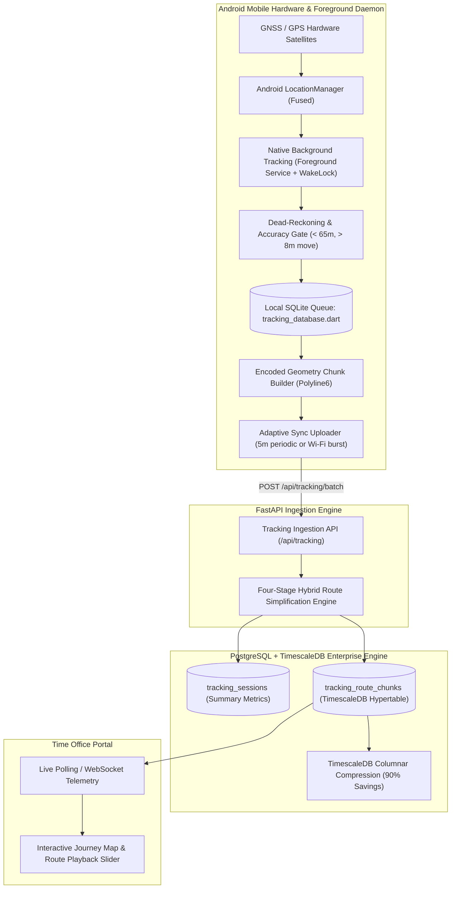
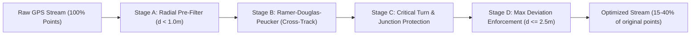

# FieldStaff AI Biometric Attendance & Field Staff Tracking Platform
## Document 04: Continuous Background Tracking & Route Optimization

---

### High-Throughput Spatial Tracking Problem

Field staff workforce operations present major geospatial engineering challenges:
1. **Scale & Storage Bloat**: 1,500 field agents transmitting raw GPS fixes every 5 seconds generate over **25.9 million rows per day** ($\approx 1.4 \text{ GB/day}$ uncompressed), rapidly degrading standard relational databases.
2. **Mobile Battery Drain**: Uncontrolled GNSS chip polling and constant cellular radio activation drain smartphone batteries within 3–4 hours.
3. **GPS Noise & Road Snapping**: Stationary employees generate "cloud jitter" (random wandering fixes within an 8-meter radius while seated at a desk), creating false travel mileage.
4. **Cellular Disconnections**: Field officers traveling through rural zones or basements encounter prolonged dead zones.

The FieldStaff platform addresses these challenges through a **Four-Stage Hybrid Route Simplification Pipeline**, **Android Foreground WakeLock Services**, **Local SQLite Chunk Caching**, and **TimescaleDB Columnar Compressed Hypertables**.

---

### End-to-End Tracking Architecture



---

### Mobile Background Service & Battery Conservation

To prevent the Android OS (Android 10 through 14+) from putting background location tracking into deep Doze mode:

1. **Persistent Foreground Service**: Runs with a sticky foreground notification displaying real-time tracking status and shift timers.
2. **Partial WakeLock Management**: Holds a restricted `PARTIAL_WAKE_LOCK` acquired through the Android `PowerManager` during active shifts, releasing it immediately upon punch-out.
3. **Adaptive Displacement Filtering**:
   - Instead of aggressive time-only polling (e.g. every 1 second regardless of movement), the service uses a dual trigger:
     $$\Delta t \ge 10 \text{ s} \quad \text{OR} \quad \Delta s \ge 15 \text{ meters}$$
   - When stationary (speed $< 0.5 \text{ m/s}$ for $> 3 \text{ minutes}$), the GNSS receiver shifts to low-power duty cycling.

---

### Four-Stage Hybrid Route Simplification Engine

Implemented in [route_simplification_service.py](file:///d:/Attend/Backup/backend/app/services/route_simplification_service.py) on the backend and mirrored in [route_simplifier.dart](file:///d:/Attend/Backup/mobile/mobile/lib/core/services/route_simplifier.dart) on mobile, this pipeline achieves **60% to 85% point reduction** while preserving road curves, intersections, and milestones:



#### Stage A: Radial Distance Pre-Filter
- Eliminates microscopic stationary jitter.
- Consecutive points separated by great-circle distance $d < 1.0 \text{ meter}$ are merged into the preceding vertex unless a significant time gap ($> 15 \text{ min}$) is detected.

#### Stage B: Ramer-Douglas-Peucker (RDP) Algorithm
Given a polyline between start point $A$ and end point $B$, compute the perpendicular cross-track distance $h$ for every intermediate point $P$:

$$\text{Semiperimeter } s = \frac{d(A,B) + d(A,P) + d(B,P)}{2}$$
$$\text{Area } K = \sqrt{s(s - d(A,B))(s - d(A,P))(s - d(B,P))}$$
$$\text{Perpendicular Height } h = \frac{2K}{d(A,B)}$$

- If $\max(h) > \epsilon$, the point with the maximum deviation is retained as a split vertex, and the algorithm recurses on both halves.
- **Adaptive Epsilon**:
  - $\epsilon_{\text{base}} = 0.8 \text{ meters}$
  - $\epsilon_{\text{straight}} = 1.2 \text{ meters}$ (on straight highway corridors)
  - $\epsilon_{\text{turn}} = 0.4 \text{ meters}$ (near curves and junctions)

#### Stage C: Critical Turn & Junction Protection
- Calculates forward and backward bearings:
  $$\theta = \text{atan2}\left(\sin(\Delta \lambda)\cos(\phi_2), \cos(\phi_1)\sin(\phi_2) - \sin(\phi_1)\cos(\phi_2)\cos(\Delta \lambda)\right)$$
- If the angular change between segments exceeds $\Delta \theta \ge 15.0^{\circ}$ over a distance $> 3.0 \text{ meters}$, the apex vertex is marked as **PROTECTED** and cannot be pruned by RDP. This prevents clipping sharp road turns into straight lines crossing buildings.

#### Stage D: Cross-Track Error Bound Validation
- Evaluates the reconstructed polyline against all discarded points.
- If any discarded raw point deviates from the simplified polyline by more than $\delta_{\text{max}} = 2.5 \text{ meters}$, the point with maximum violation is restored, guaranteeing spatial integrity.

---

### Local SQLite Storage & Disconnected Operations

When working in basements, rural zones, or during cellular outages, fixes are buffered in the device's encrypted SQLite database ([tracking_database.dart](file:///d:/Attend/Backup/mobile/mobile/lib/core/services/tracking_database.dart)):

```sql
CREATE TABLE local_gps_breadcrumbs (
    id INTEGER PRIMARY KEY AUTOINCREMENT,
    session_uuid TEXT NOT NULL,
    latitude REAL NOT NULL,
    longitude REAL NOT NULL,
    accuracy REAL NOT NULL,
    speed REAL,
    bearing REAL,
    altitude REAL,
    is_mocked INTEGER DEFAULT 0,
    recorded_at TEXT NOT NULL,
    synced_status INTEGER DEFAULT 0 -- 0: Pending, 1: Synced, 2: Rejected
);
CREATE INDEX idx_breadcrumbs_sync ON local_gps_breadcrumbs(synced_status, session_uuid);
```

#### Sync Strategy
1. **Batch Assembly**: Compresses pending points into JSON blocks of 50–100 items.
2. **Idempotent Ingestion**: Server uses `session_uuid` and `chunk_sequence` to reject duplicate transmissions during network drops.
3. **Local Pruning**: Synced points are pruned every 7 days to maintain a small database footprint.

---

### PostgreSQL + TimescaleDB Enterprise Architecture

On the server, telemetry is stored using **PostgreSQL with the TimescaleDB extension** ([timescaledb_setup.sql](file:///d:/Attend/Backup/timescaledb_setup.sql)):

```sql
-- Convert route chunks into a TimescaleDB Hypertable partitioned by 7-day chunks
SELECT create_hypertable(
    'tracking_route_chunks',
    'created_at',
    chunk_time_interval => INTERVAL '7 days',
    if_not_exists => TRUE
);

-- Native Columnar Compression (90% Storage Reduction)
ALTER TABLE tracking_route_chunks SET (
    timescaledb.compress,
    timescaledb.compress_segmentby = 'session_id',
    timescaledb.compress_orderby = 'chunk_sequence ASC, created_at ASC'
);

-- Automatic compression of data older than 2 days
SELECT add_compression_policy('tracking_route_chunks', INTERVAL '2 days', if_not_exists => TRUE);

-- Automatic data retention policy (prune raw chunks older than 90 days)
SELECT add_retention_policy('tracking_route_chunks', INTERVAL '90 days', if_not_exists => TRUE);
```

#### Storage & Performance Comparison

| Metric | Standard PostgreSQL B-Tree | TimescaleDB Hypertable + Columnar Compression |
|---|---|---|
| **Storage per 1,500 Users / Day** | $1,420 \text{ MB / day}$ | **$142 \text{ MB / day}$** (90% reduction) |
| **Storage per Year** | $\approx 518 \text{ GB}$ | **$\approx 51.8 \text{ GB}$** |
| **Query Speed (Route Replay)** | Index scan over 25M rows (12–18s) | Chunk-pruned decompression (**< 220ms**) |
| **Write Throughput** | Heavy WAL lock contention | Partitioned direct append buffer |

---

### Real-Time Live Pings & Route Playback

The Time Office web and desktop portals consume telemetry through two primary query patterns:

1. **Live Status Polling (`GET /api/tracking/live-locations`)**:
   Returns the latest coordinates, current speed, battery level, moving status (Moving, Stationary, Offline), and last-seen timestamp for all active field staff.
2. **Historical Replay Query (`GET /api/tracking/sessions/{id}/route`)**:
   Returns the simplified polyline with temporal milestones:
   - Green markers: Shift Start / Punch In.
   - Blue polyline: Simplified journey trail.
   - Orange stop pins: Stationary stops exceeding 5 minutes (displaying duration in minutes).
   - Red marker: Shift End / Punch Out.
   - Summary telemetry: Total distance (km), active travel time, stationary idle time, and average speed.

---
*Proceed to [Document 05: FastAPI Backend & Core Services](file:///d:/Attend/Backup/docs/05_FASTAPI_BACKEND_AND_CORE_SERVICES.md) for details on the shift engine, attendance decision matrix, and background schedulers.*
