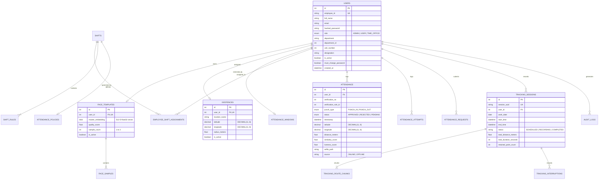

# FieldStaff AI Biometric Attendance & Field Staff Tracking Platform
## Document 06: Database Models & Schema Design

---

### Dual Database Paradigm

The FieldStaff platform operates on a **hybrid persistence model**:
1. **Relational Core (PostgreSQL / MySQL / SQLite)**: Manages strict ACID transactions, foreign key integrity, and relational joins for employees, authentication, shifts, attendance punches, and policies.
2. **Time-Series Hypertable (TimescaleDB Extension)**: Manages high-velocity GPS breadcrumb telemetry with chunk-based temporal partitioning and native columnar compression.

---

### Relational Entity-Relationship Diagram



---

### Detailed Table Definitions & ORM Schemas

#### 1. `users` Table
Stores enterprise personnel records and role-based access attributes.

```sql
CREATE TABLE users (
    id INT AUTO_INCREMENT PRIMARY KEY,
    employee_id VARCHAR(64) UNIQUE NOT NULL,
    full_name VARCHAR(128) NOT NULL,
    email VARCHAR(128) NULL,
    hashed_password VARCHAR(255) NOT NULL,
    role ENUM('ADMIN', 'USER', 'TIME_OFFICE') NOT NULL DEFAULT 'USER',
    department VARCHAR(128) NULL,
    department_id INT NULL,
    unit_number INT NULL,
    designation VARCHAR(128) NULL,
    is_active BOOLEAN NOT NULL DEFAULT TRUE,
    must_change_password BOOLEAN NOT NULL DEFAULT TRUE,
    created_at DATETIME NOT NULL DEFAULT CURRENT_TIMESTAMP,
    updated_at DATETIME NOT NULL DEFAULT CURRENT_TIMESTAMP ON UPDATE CURRENT_TIMESTAMP,
    INDEX idx_users_emp_id (employee_id),
    INDEX idx_users_role (role),
    INDEX idx_users_dept (department_id)
);
```

#### 2. `face_templates` & `face_samples` Tables
Stores the normalized 512-dimensional biometric feature embeddings.

```sql
CREATE TABLE face_templates (
    id INT AUTO_INCREMENT PRIMARY KEY,
    user_id INT UNIQUE NOT NULL,
    master_embedding MEDIUMBLOB NOT NULL, -- 512 * 4 bytes = 2048 bytes (float32 array)
    quality_score FLOAT NOT NULL DEFAULT 0.0,
    sample_count INT NOT NULL DEFAULT 0,
    is_active BOOLEAN NOT NULL DEFAULT TRUE,
    created_at DATETIME NOT NULL DEFAULT CURRENT_TIMESTAMP,
    updated_at DATETIME NOT NULL DEFAULT CURRENT_TIMESTAMP ON UPDATE CURRENT_TIMESTAMP,
    FOREIGN KEY (user_id) REFERENCES users(id) ON DELETE CASCADE
);

CREATE TABLE face_samples (
    id INT AUTO_INCREMENT PRIMARY KEY,
    template_id INT NOT NULL,
    sample_index INT NOT NULL, -- 1, 2, or 3
    embedding MEDIUMBLOB NOT NULL,
    crop_image_path VARCHAR(255) NOT NULL,
    quality_score FLOAT NOT NULL,
    created_at DATETIME NOT NULL DEFAULT CURRENT_TIMESTAMP,
    FOREIGN KEY (template_id) REFERENCES face_templates(id) ON DELETE CASCADE
);
```

#### 3. `geofences` Table
Stores geographic boundaries with micro-coordinate precision (`DECIMAL(11, 8)`).

```sql
CREATE TABLE geofences (
    id INT AUTO_INCREMENT PRIMARY KEY,
    user_id INT UNIQUE NOT NULL,
    location_name VARCHAR(128) NOT NULL,
    latitude DECIMAL(11, 8) NOT NULL,
    longitude DECIMAL(11, 8) NOT NULL,
    radius_meters FLOAT NOT NULL DEFAULT 100.0,
    is_active BOOLEAN NOT NULL DEFAULT TRUE,
    created_at DATETIME NOT NULL DEFAULT CURRENT_TIMESTAMP,
    updated_at DATETIME NOT NULL DEFAULT CURRENT_TIMESTAMP ON UPDATE CURRENT_TIMESTAMP,
    FOREIGN KEY (user_id) REFERENCES users(id) ON DELETE CASCADE
);
```

#### 4. `attendance` & `attendance_attempts` Tables
Authoritative log of successful punches and audited attempts.

```sql
CREATE TABLE attendance (
    id INT AUTO_INCREMENT PRIMARY KEY,
    user_id INT NOT NULL,
    verification_no INT NOT NULL DEFAULT 1,
    verification_rule_id INT NULL,
    punch_type ENUM('PUNCH_IN', 'PUNCH_OUT') NOT NULL,
    status ENUM('APPROVED', 'REJECTED', 'PENDING') NOT NULL DEFAULT 'APPROVED',
    timestamp DATETIME NOT NULL,
    latitude DECIMAL(11, 8) NOT NULL,
    longitude DECIMAL(11, 8) NOT NULL,
    distance_meters FLOAT NOT NULL,
    face_similarity_score FLOAT NOT NULL,
    liveness_score FLOAT NOT NULL,
    selfie_image_path VARCHAR(255) NULL,
    device_id VARCHAR(128) NULL,
    source ENUM('ONLINE', 'OFFLINE') NOT NULL DEFAULT 'ONLINE',
    created_at DATETIME NOT NULL DEFAULT CURRENT_TIMESTAMP,
    FOREIGN KEY (user_id) REFERENCES users(id) ON DELETE CASCADE,
    INDEX idx_attendance_user_date (user_id, timestamp),
    INDEX idx_attendance_status (status)
);

CREATE TABLE attendance_attempts (
    id INT AUTO_INCREMENT PRIMARY KEY,
    user_id INT NOT NULL,
    verification_no INT NULL,
    verification_rule_id INT NULL,
    timestamp DATETIME NOT NULL,
    attempt_status ENUM('APPROVED', 'REJECTED') NOT NULL,
    rejection_reason VARCHAR(64) NULL,
    latitude DECIMAL(11, 8) NULL,
    longitude DECIMAL(11, 8) NULL,
    distance_meters FLOAT NULL,
    similarity_score FLOAT NULL,
    liveness_score FLOAT NULL,
    ip_address VARCHAR(45) NULL,
    device_id VARCHAR(128) NULL,
    created_at DATETIME NOT NULL DEFAULT CURRENT_TIMESTAMP,
    FOREIGN KEY (user_id) REFERENCES users(id) ON DELETE CASCADE,
    INDEX idx_attempts_user_time (user_id, timestamp)
);
```

#### 5. `shifts` & `shift_rules` Tables
Encapsulates configurable operational schedules and punch periods.

```sql
CREATE TABLE shifts (
    id INT AUTO_INCREMENT PRIMARY KEY,
    shift_code VARCHAR(32) UNIQUE NOT NULL,
    shift_name VARCHAR(128) NOT NULL,
    start_time TIME NOT NULL,
    end_time TIME NOT NULL,
    grace_period_minutes INT NOT NULL DEFAULT 15,
    half_day_threshold_minutes INT NOT NULL DEFAULT 240,
    full_day_threshold_minutes INT NOT NULL DEFAULT 480,
    is_overnight BOOLEAN NOT NULL DEFAULT FALSE,
    timezone VARCHAR(64) NOT NULL DEFAULT 'Asia/Kolkata',
    is_active BOOLEAN NOT NULL DEFAULT TRUE,
    created_at DATETIME NOT NULL DEFAULT CURRENT_TIMESTAMP,
    updated_at DATETIME NOT NULL DEFAULT CURRENT_TIMESTAMP ON UPDATE CURRENT_TIMESTAMP
);

CREATE TABLE shift_rules (
    id INT AUTO_INCREMENT PRIMARY KEY,
    shift_id INT NOT NULL,
    verification_no INT NOT NULL DEFAULT 1,
    event_type VARCHAR(32) NOT NULL, -- PUNCH_IN, PUNCH_OUT, MID_DAY
    window_start TIME NOT NULL,
    window_end TIME NOT NULL,
    show_in_user_schedule BOOLEAN NOT NULL DEFAULT TRUE,
    result_classification VARCHAR(64) NULL,
    created_at DATETIME NOT NULL DEFAULT CURRENT_TIMESTAMP,
    FOREIGN KEY (shift_id) REFERENCES shifts(id) ON DELETE CASCADE
);
```

#### 6. `tracking_sessions` & `tracking_route_chunks` (TimescaleDB)
High-throughput tracking tables described in Document 04.

```sql
CREATE TABLE tracking_sessions (
    id SERIAL PRIMARY KEY,
    session_uuid VARCHAR(64) UNIQUE NOT NULL,
    user_id INT NOT NULL,
    work_date DATE NOT NULL DEFAULT CURRENT_DATE,
    start_time TIMESTAMPTZ NOT NULL DEFAULT NOW(),
    end_time TIMESTAMPTZ NULL,
    status VARCHAR(32) NOT NULL DEFAULT 'RECORDING',
    total_distance_meters DOUBLE PRECISION NOT NULL DEFAULT 0.0,
    total_duration_seconds INT NOT NULL DEFAULT 0,
    retained_point_count INT NOT NULL DEFAULT 0,
    last_accepted_latitude NUMERIC(11, 8) NULL,
    last_accepted_longitude NUMERIC(11, 8) NULL,
    last_sync_time TIMESTAMPTZ NULL
);
```

---

### Dynamic Schema Migration Engine

In [database.py](file:///d:/Attend/Backup/backend/app/database.py), the `run_auto_migrations()` routine automatically inspects the database upon server boot and executes idempotent `ALTER TABLE` statements:

1. **Inspector Discovery**: Queries table names and columns using SQLAlchemy's `inspect(engine)`.
2. **Non-Destructive Column Additions**: Safely adds missing columns without data loss:
   ```python
   def safe_add_column(table_name, col_name, sql_clause):
       if table_name in tables:
           columns = [c["name"] for c in inspector.get_columns(table_name)]
           if col_name not in columns:
               with target_engine.begin() as conn:
                   conn.execute(text(f"ALTER TABLE {table_name} ADD COLUMN {col_name} {sql_clause}"))
   ```
3. **Cross-Database Compatibility**: Intelligently differentiates SQLite from MySQL/PostgreSQL (avoiding unsupported `ALTER TABLE MODIFY COLUMN` syntax on SQLite).

---
*Proceed to [Document 07: Flutter Mobile Client Architecture](file:///d:/Attend/Backup/docs/07_FLUTTER_MOBILE_CLIENT_ARCHITECTURE.md) for UI components, Camera2 HAL integration, and local state management.*
