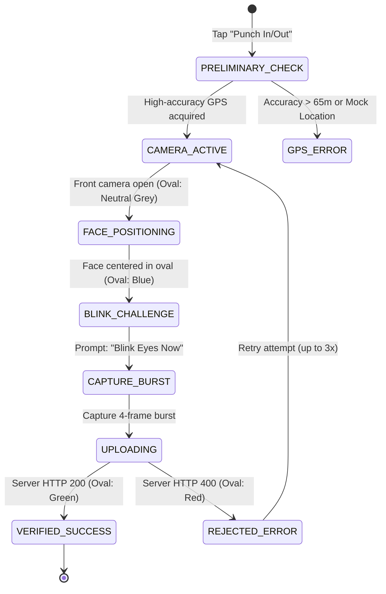
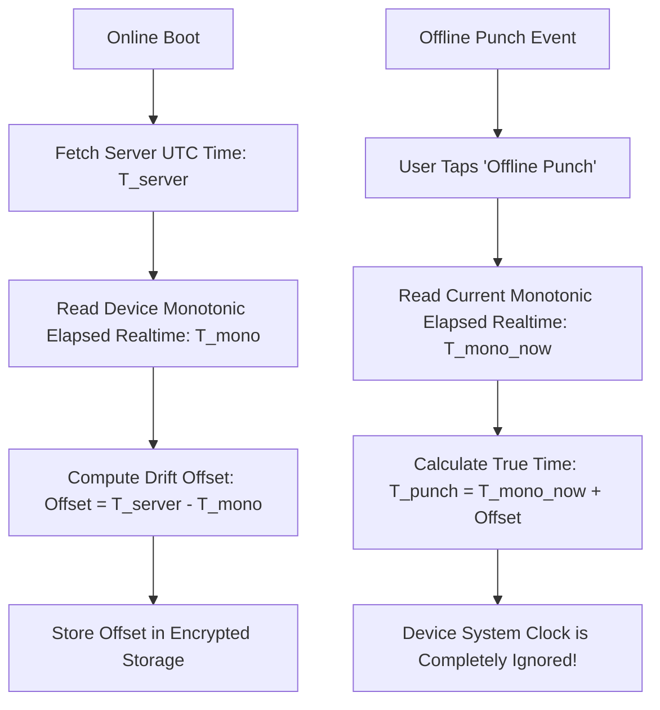

# FieldStaff AI Biometric Attendance & Field Staff Tracking Platform
## Document 07: Flutter Mobile Client Architecture

---

### Mobile Client Architecture

The mobile application is constructed using **Flutter 3.x (Dart 3.x)** targeting **Android 10 through 14+**. It operates under strict security and battery constraints, serving as an interactive biometric capture portal and continuous background location logger.

```mermaid
graph TD
    subgraph UI_Layer ["Presentation & UI Layer"]
        LOGIN["Login & Force Password Change Screen"]
        DASH["User Dashboard (Shift Timers & Geofence Meters)"]
        VERIFY["Verify Attendance Screen (Camera Oval + Blink HUD)"]
        REQUEST["Manual Regularization & Missed Punch Screen"]
        HISTORY["Attendance History & Audit Logs Screen"]
        PATCH_UI["Free Fire Patch HUD (Dynamic OTA Updater)"]
    end

    subgraph Service_Layer ["Core Services & Background Engines"]
        AUTH_SVC["AuthService (Secure Token & Biometrics)"]
        TRACK_SVC["TrackingService (Shift Lifecycle & Telemetry)"]
        LOC_SVC["LocationService (Kalman Filtered GNSS)"]
        DIST_CALC["GpsDistanceCalculator (Dead-Reckoning & Jitter)"]
        TIME_SVC["ServerTimeService (Anti-Tamper Monotonic Clock)"]
        OFFLINE_SVC["OfflineAttendanceService (Encrypted Sync Queue)"]
        PATCH_MGR["PatchManager (Dynamic Resource Replacer)"]
        APP_UPDATE["AppUpdateService (Periodic Version Check)"]
    end

    subgraph Hardware_HAL ["Hardware Abstraction Layer"]
        CAM_HAL["Android Camera2 HAL (Front Sensor)"]
        GNSS_HAL["Fused Location Provider & GPS Receiver"]
        POWER_HAL["PowerManager (Partial WakeLock)"]
        SECURE_STORAGE["EncryptedSharedPreferences / KeyStore"]
        SQLITE_STORAGE["Local SQLite Database (tracking_database.dart)"]
    end

    UI_Layer --> Service_Layer
    Service_Layer --> Hardware_HAL
```



---

### Camera2 Subsystem & Lifecycle Safety

Biometric verification requires continuous camera frames for face detection and temporal blink verification. Improper handling of the Android Camera2 HAL causes camera hardware locks and black screens.

#### Lifecycle Protection & Resource Disposal
As documented in the system audit (`BUG-001`), the camera controller lifecycle is strictly managed:

```dart
class _VerifyAttendanceScreenState extends State<VerifyAttendanceScreen> {
  CameraController? _cameraController;
  bool _isAutoLoopActive = false;

  @override
  void initState() {
    super.initState();
    _initFrontCamera();
  }

  Future<void> _initFrontCamera() async {
    final cameras = await availableCameras();
    final frontCam = cameras.firstWhere(
      (c) => c.lensDirection == CameraLensDirection.front,
      orElse: () => cameras.first,
    );

    _cameraController = CameraController(
      frontCam,
      ResolutionPreset.medium, // 720p optimal balance for ML & upload bandwidth
      enableAudio: false,
      imageFormatGroup: ImageFormatGroup.jpeg,
    );

    await _cameraController!.initialize();
    if (mounted) setState(() => _isCameraReady = true);
  }

  @override
  void dispose() {
    _isAutoLoopActive = false; // Cancel ongoing burst captures
    _cameraController?.dispose(); // Release Android Camera2 HAL
    super.dispose();
  }
}
```

---

### Biometric Verification Screen (Oval HUD & Active Blink)

In [verify_attendance_screen.dart](file:///d:/Attend/Backup/mobile/mobile/lib/screens/user/verify_attendance_screen.dart), the user interface guides the employee through a guided capture sequence:



#### Oval HUD Visual States:
- **`OvalState.neutral` (Grey)**: "Position face inside frame."
- **`OvalState.detecting` (Blue Pulsing)**: "Face detected. Hold still..."
- **`OvalState.matched` (Solid Emerald Green)**: "Attendance Verified Successfully!" Displays check-in time, shift name, and punctuality status.
- **`OvalState.mismatch` (Red Warning)**: Displays exact server reason (e.g. "Outside Assigned Work Location", "Eye blink not detected").

---

### User Dashboard Architecture

The [user_dashboard_screen.dart](file:///d:/Attend/Backup/mobile/mobile/lib/screens/user/user_dashboard_screen.dart) serves as the primary home screen:

1. **Shift Schedule Card**:
   - Queries `GET /api/shift-engine/next-event`.
   - Displays current shift name, start/end timings, and live countdown timer to the next punch window.
2. **Geofence Proximity Radar**:
   - Computes distance to assigned geofence in real time.
   - Color coded:
     - 🟢 **Green**: Within radius ($d \le \text{radius}$).
     - 🟡 **Yellow**: Near perimeter ($d \le \text{radius} + 100\text{m}$).
     - 🔴 **Red**: Outside boundary ($d > \text{radius} + 100\text{m}$).
3. **Tracking & Battery Status Bar**:
   - Displays real-time GPS telemetry: Active satellites lock, horizontal accuracy in meters, and background sync heartbeat indicator.

---

### Offline Punch Capture & Anti-Tamper Clock

When network connectivity is unavailable, the mobile client falls back to the **Offline Attendance Engine** ([offline_attendance_service.dart](file:///d:/Attend/Backup/mobile/mobile/lib/core/services/offline_attendance_service.dart)).

#### The Threat of Device Clock Manipulation
A common field worker fraud technique involves setting the smartphone's system clock backward (e.g. changing 10:15 AM to 08:55 AM) to fake punctuality.

#### Server-Anchored Monotonic Protection:


- Android's `SystemClock.elapsedRealtime()` measures milliseconds since device boot, and **cannot be altered by the user or system settings**.
- Punches captured offline are cryptographically signed with the monotonic reference and queued in local SQLite storage.
- When connectivity resumes, the queue synchronizes with `/api/user/attendance/sync-offline`.

---

### Multi-Language Localization Engine

The mobile client features dynamic runtime language switching across **English**, **Marathi (मराठी)**, and **Hindi (हिंदी)** without restarting the application:

- Managed by `LanguageService` and `AppTranslations`.
- Translated strings cover all biometric error codes, punch confirmation dialogues, shift timers, and navigation labels.
- Automatically selects the user's preferred regional language during initial onboarding.

---
*Proceed to [Document 08: Time Office Portal (Web & Desktop)](file:///d:/Attend/Backup/docs/08_TIME_OFFICE_PORTAL_WEB_AND_DESKTOP.md) for administrative management, live Leaflet tracking, and reporting tools.*
