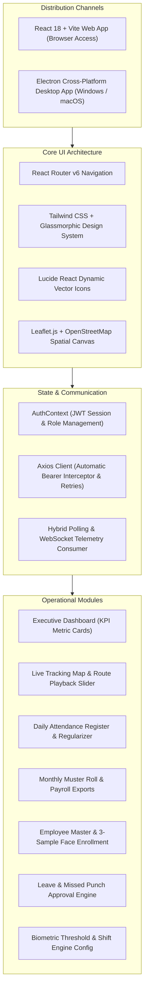
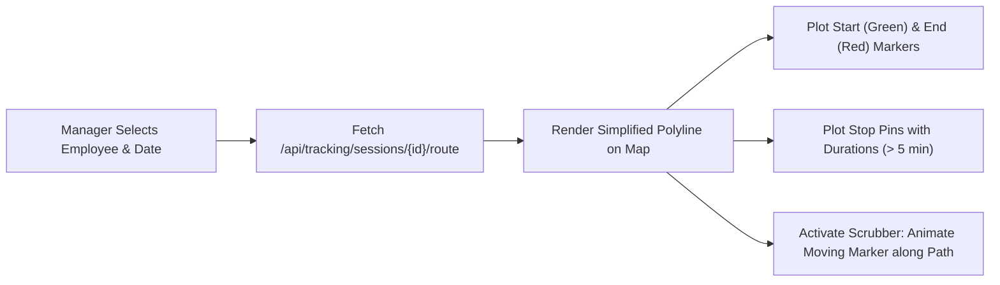

# FieldStaff AI Biometric Attendance & Field Staff Tracking Platform
## Document 08: Time Office Portal (Web & Electron Desktop)

---

### Portal Architecture & Technology Stack

The **Time Office Portal** provides human resources personnel, shift supervisors, and operational controllers with real-time visibility into workforce attendance, spatial movements, and compliance.



---

### Core Functional Modules

#### 1. Executive Dashboard (`Dashboard.jsx`)
- **Key Performance Indicators (KPIs)**:
  - *Total Onboarded Field Staff*
  - *Today Present Count* (calculated against dynamic shift schedules)
  - *On-Time vs Late Mark Punches*
  - *Outside Geofence Rejected Attempts*
  - *Active Field Staff Moving Now*
- **Real-Time Punch Feed**: Live scrolling stream of employee punch events displaying name, department, punch direction (IN/OUT), and biometric match confidence.

#### 2. Live Tracking Map (`LiveTrackingMap.jsx`)
Features a full-screen geospatial control center built on Leaflet:
- **Pulsing Directional SVG Markers**:
  - Dynamically rotates the marker icon based on the employee's heading azimuth ($0^{\circ}$ to $360^{\circ}$).
  - Outer CSS pulse animation indicates active movement.
  - Color coded: Blue (Moving), Yellow (Stationary/Idle), Grey (Offline/GPS Lost).
- **Interactive Multi-Agent Search**:
  - Instant filtering by employee ID, full name, department, or vehicle unit.
  - "Follow Mode": Automatically pans and zooms the map to track a selected agent.
- **Route Replay Slider**:
  - Fetches the simplified RDP polyline for any historical date.
  - Scrubbable time slider allowing managers to play back travel journeys at $1\times$, $5\times$, or $20\times$ speeds.
  - Highlights stationary stops with custom pins displaying duration (e.g. "Stopped: 42 mins").



#### 3. Daily Attendance Register (`DailyAttendance.jsx`)
- Filterable by date, department, shift code, and status (`APPROVED`, `LATE`, `HALF_DAY`, `ABSENT`).
- **Manual Punch Entry Modal**: Allows authorized supervisors to log manual overrides with required justification notes.
- **Dynamic Shift Assignment**: Reassign an employee to a different shift on the fly.
- **Bulk Recalculation Engine**: Re-evaluates daily summaries across all employees after updating shift policies or grace thresholds.

#### 4. Monthly Reports & Payroll Exporter (`MonthlyReports.jsx`)
- Generates standard 31-day corporate muster rolls.
- Computes total payable days, approved leaves, weekly offs, half-day deductions, and overtime hours.
- Direct export to **CSV**, **Excel (.xlsx)**, and **PDF** formats for integration with ERP systems (SAP, Tally, Zoho People).

#### 5. Employee Master & Biometric Enrollment (`Employees.jsx`)
- Full CRUD operations on staff profiles.
- **Integrated Camera Enrollment Wizard**:
  - Launches front/USB webcam directly within the browser/desktop app.
  - Guided 3-step capture ensuring clear lighting and distinct angles.
  - Live preview of quality scores and real-time validation against the backend ArcFace embedding pipeline.
- Geofence assignment tool: Set latitude, longitude, and radius meters via an interactive map picker.

#### 6. Leave & Regularization Approval Workflow (`Leaves.jsx`)
- Employees can submit missed punch regularizations or leave requests from the mobile app.
- Supervisors view submitted evidence (selfie image, location at time of request, written reason).
- One-click *Approve* or *Reject* with immediate push notification to the employee's phone.

#### 7. System Settings & Biometric Calibration (`Settings.jsx`)
- Adjust global biometric thresholds:
  - `SIMILARITY_THRESHOLD`: Default `0.65` (adjustable between 0.50 and 0.85).
  - `SPOOF_DETECTION_THRESHOLD`: Default `0.70`.
  - `INDOOR_ENHANCEMENT_ENABLED`: Toggle CLAHE illumination boost.
- Shift configuration: Grace periods, half-day hour cutoffs, late-mark penalty rules.

---

### Electron Desktop Packaging (`time_office_desktop`)

For security-conscious corporate environments requiring dedicated desktop workstations:

```javascript
// electron/main.js
const { app, BrowserWindow, ipcMain } = require('electron');
const path = require('path');

function createWindow() {
  const win = new BrowserWindow({
    width: 1440,
    height: 900,
    minWidth: 1024,
    minHeight: 700,
    title: 'FieldStaff Time Office Management Station',
    webPreferences: {
      preload: path.join(__dirname, 'preload.js'),
      nodeIntegration: false,
      contextIsolation: true, // Secure context isolation
      webSecurity: true,
    },
    icon: path.join(__dirname, '../public/favicon.ico')
  });

  if (process.env.NODE_ENV === 'development') {
    win.loadURL('http://localhost:5173');
  } else {
    win.loadFile(path.join(__dirname, '../dist/index.html'));
  }
}
```

#### Desktop Specific Features:
- Native Windows system tray integration with real-time desktop notifications on critical attendance anomalies.
- Hardware acceleration for smooth rendering of 1,000+ simultaneous map markers.
- Auto-launch on Windows startup for dedicated monitoring displays.

---
*Proceed to [Document 09: Dynamic OTA Patching & DevOps Deployment](file:///d:/Attend/Backup/docs/09_OTA_PATCHING_FREE_FIRE_HUD_AND_DEVOPS.md) for details on the gaming HUD updater, IIS hosting, and system scripts.*
