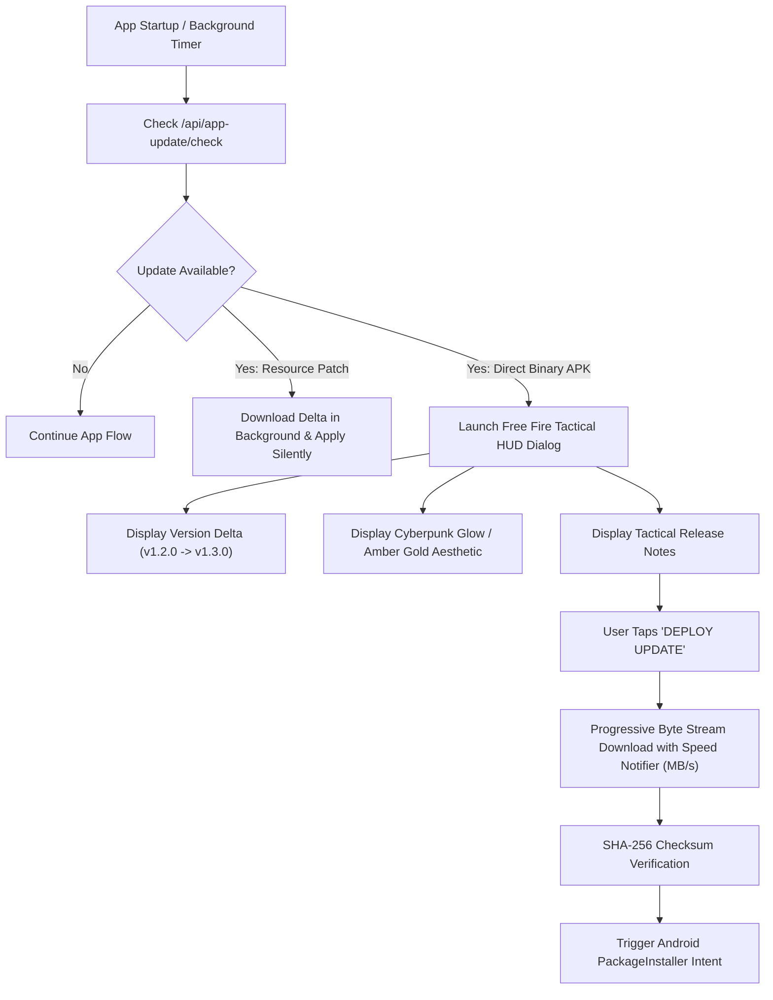
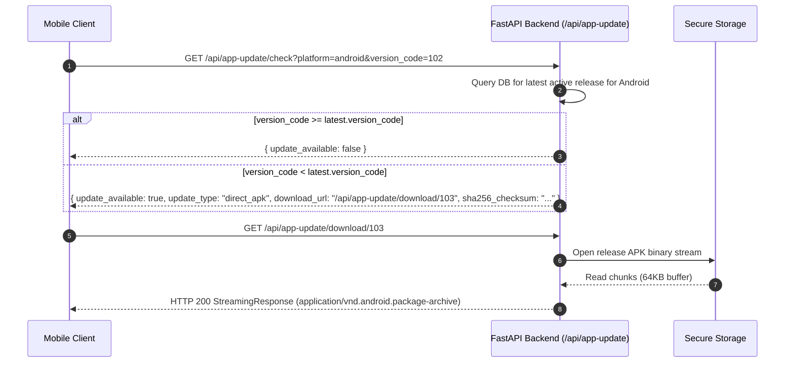
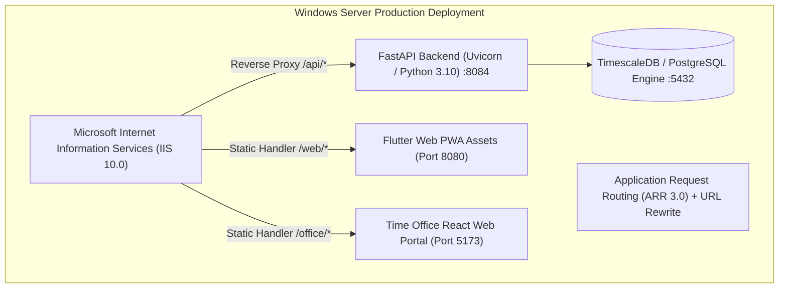

# FieldStaff AI Biometric Attendance & Field Staff Tracking Platform
## Document 09: Dynamic OTA Patching, Free Fire HUD & DevOps Deployment

---

### Dynamic Over-The-Air (OTA) Patching Paradigm

Enterprise mobile applications deployed across thousands of field personnel frequently face deployment friction:
- Google Play Store app review cycles take 24 to 72 hours, delaying critical bug fixes.
- Field workers ignore app update prompts, leading to fragmented version landscapes.
- Full APK downloads (40MB–70MB) consume field workers' cellular mobile data quotas.

The FieldStaff platform solves this with a **Dual-Tier Dynamic OTA Updating Architecture**:
1. **Tier 1: Silent Resource Patches (`resource_patch`)**: Downloads lightweight delta patches (assets, configs, translations, business rules) in the background without requiring user interaction or APK re-installation.
2. **Tier 2: Tactical APK Downloader (`direct_apk`)**: Delivers full binary upgrades via an interactive, high-tech military HUD inspired by popular mobile games (Free Fire / Cyberpunk).

---

### The Free Fire Tactical Patch HUD

Implemented in [free_fire_patch_hud.dart](file:///d:/Attend/Backup/mobile/mobile/lib/widgets/update/free_fire_patch_hud.dart):



#### HUD Design & Visual Features:
- **Cyber Aesthetic**: Deep obsidian backdrop (`#0A0F1D`), hexagonal grid motifs, pulsating tactical accents (Cyber Cyan `#00E5FF` for resource patches, Amber Gold `#FFFF9900` for major binary APKs).
- **Real-Time Telemetry Bar**: Shows active download speed ($\text{MB/s}$), transferred megabytes vs total size, and percentage progress.
- **Mandatory vs Voluntary Enforcer**: If `isMandatory = true`, Android back button dismissals (`WillPopScope`) are blocked, preventing staff from clocking in with outdated, vulnerable clients.

---

### Backend Update Engine (`app_update.py`)

The backend engine manages version manifests, platform targets, and binary streaming:



---

### Production Deployment & Operating Environments

The FieldStaff ecosystem supports deployment across Windows Server environments (via IIS and Windows Services) and Linux container environments (via Docker Compose).



---

### IIS Configuration & PowerShell Automation

The included PowerShell deployment script ([setup_iis_flutter_web.ps1](file:///d:/Attend/Backup/setup_iis_flutter_web.ps1)) configures Microsoft IIS:

1. **Role & Module Provisioning**:
   - Enables `Web-Server`, `Web-Asp-Net45`, `Web-WebSockets`, and `Web-Http-Redirect`.
   - Automatically installs URL Rewrite 2.1 and Application Request Routing (ARR 3.0).
2. **Reverse Proxy Rules ([backend/web.config](file:///d:/Attend/Backup/backend/web.config))**:
   ```xml
   <configuration>
     <system.webServer>
       <rewrite>
         <rules>
           <rule name="FastAPI Reverse Proxy" stopProcessing="true">
             <match url="^api/(.*)" />
             <action type="Rewrite" url="http://127.0.0.1:8084/api/{R:1}" />
           </rule>
         </rules>
       </rewrite>
       <httpProtocol>
         <customHeaders>
           <add name="X-Content-Type-Options" value="nosniff" />
           <add name="X-Frame-Options" value="SAMEORIGIN" />
         </customHeaders>
       </httpProtocol>
     </system.webServer>
   </configuration>
   ```

---

### Windows Execution Scripts

The repository includes preconfigured batch scripts for local and on-premise server operation:

| Batch Script | Path | Function |
|---|---|---|
| `start_time_office.bat` | [start_time_office.bat](file:///d:/Attend/Backup/start_time_office.bat) | Master startup: Launches Backend API, React Web Portal, and checks database connectivity. |
| `start_time_office_pc.bat` | [start_time_office_pc.bat](file:///d:/Attend/Backup/start_time_office_pc.bat) | Launches the Time Office Electron Desktop client in kiosk monitoring mode. |
| `start_time_office_web.bat` | [start_time_office_web.bat](file:///d:/Attend/Backup/start_time_office_web.bat) | Builds and hosts the React 18 production bundle via a lightweight HTTP daemon. |
| `run_backend.bat` | [backend/run_backend.bat](file:///d:/Attend/Backup/backend/run_backend.bat) | Activates Python virtual environment and starts Uvicorn with auto-reload on port 8084. |

---

### Dockerized Multi-Container Topology

For Linux production environments, the platform provides a complete containerized stack:

```yaml
version: '3.8'

services:
  db:
    image: timescale/timescaledb:latest-pg15
    restart: always
    environment:
      POSTGRES_DB: fieldstaff_attendance
      POSTGRES_USER: attend_user
      POSTGRES_PASSWORD: ${DB_PASSWORD}
    volumes:
      - pgdata:/var/lib/postgresql/data
      - ./timescaledb_setup.sql:/docker-entrypoint-initdb.d/01_setup.sql
    ports:
      - "5432:5432"

  backend:
    build: ./backend
    restart: always
    depends_on:
      - db
    environment:
      - DATABASE_URL=postgresql://attend_user:${DB_PASSWORD}@db:5432/fieldstaff_attendance
      - SIMILARITY_THRESHOLD=0.65
      - ONNX_NUM_THREADS=4
    ports:
      - "8084:8084"
    volumes:
      - ./backend/weights:/app/weights
      - ./backend/uploads:/app/uploads

  time_office:
    build: ./time_office
    restart: always
    ports:
      - "80:80"
    depends_on:
      - backend

volumes:
  pgdata:
```

---
*Proceed to [Document 10: API Reference, Security & Troubleshooting](file:///d:/Attend/Backup/docs/10_API_REFERENCE_SECURITY_AND_TROUBLESHOOTING.md) for the complete endpoint catalog, authentication schemes, and disaster recovery procedures.*
