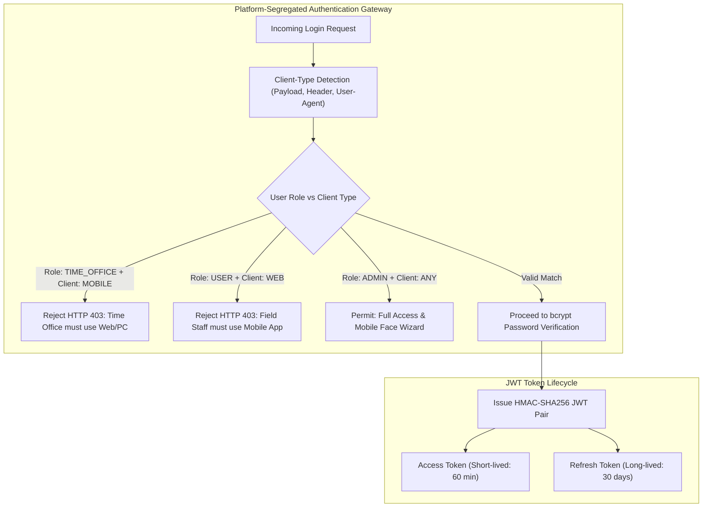

# FieldStaff AI Biometric Attendance & Field Staff Tracking Platform
## Document 10: API Reference, Security Architecture & Troubleshooting Playbook

---

### Security Architecture & Threat Model

The platform operates under a **Zero-Trust Client** security model, strictly segregating roles, client platforms, and cryptographic credentials.



#### Key Security Defenses:
1. **Platform Segregation**: Prevents malicious actors from using employee credentials inside web browsers to bypass mobile GPS hardware checks.
2. **Device Hardware Fingerprinting**: Mobile requests bind to unique device hardware identifiers (`device_id`). Attempts to punch from unauthorized third-party devices trigger security flags.
3. **Anti-Clock Tampering**: Offline punches are validated using server-synchronized monotonic hardware counters, rendering local device clock rollbacks ineffective.

---

### REST API Reference Catalog

#### 1. Authentication Endpoints (`/api/auth`)

##### `POST /api/auth/login`
Authenticates user, validates client platform, and returns JWT tokens.
- **Request Body**:
  ```json
  {
    "employee_id": "2668",
    "password": "password123",
    "client_type": "MOBILE" // "MOBILE" | "WEB"
  }
  ```
- **Response `200 OK`**:
  ```json
  {
    "access_token": "eyJhbGciOiJIUzI1NiIs...",
    "refresh_token": "eyJhbGciOiJIUzI1NiIs...",
    "token_type": "bearer",
    "must_change_password": false,
    "user": {
      "id": 14,
      "employee_id": "2668",
      "full_name": "Rajesh Kumar",
      "role": "USER",
      "department": "Distribution Logistics"
    }
  }
  ```

##### `POST /api/auth/change-password`
Forces new employees to change default credentials prior to accessing operations.
- **Headers**: `Authorization: Bearer <token>`
- **Request Body**:
  ```json
  {
    "current_password": "2668",
    "new_password": "NewSecurePassword#2026"
  }
  ```

---

#### 2. Biometric Attendance Endpoints (`/api/user/attendance`)

##### `POST /api/user/attendance/verify`
Authoritative multi-factor verification endpoint (Geofence + Biometrics + Shift Window).
- **Headers**: `Authorization: Bearer <token>`
- **Request Body**:
  ```json
  {
    "latitude": 18.5204303,
    "longitude": 73.8567437,
    "accuracy": 12.4,
    "device_id": "a4b12c8e9f01",
    "active_verification_no": 1,
    "active_verification_rule_id": 4,
    "frames": [
      "<base64_frame_1>",
      "<base64_frame_2>",
      "<base64_frame_3>",
      "<base64_frame_4>"
    ]
  }
  ```
- **Response `200 OK`**:
  ```json
  {
    "success": true,
    "status": "APPROVED",
    "message": "Attendance verified successfully",
    "timestamp": "2026-10-23T08:31:12.450Z",
    "face_similarity": 0.742,
    "distance_meters": 18.6,
    "shift_name": "General Field Shift",
    "punctuality": "ON_TIME"
  }
  ```
- **Error Responses**:
  - `400 OUTSIDE_ASSIGNED_AREA`: Distance exceeds allowed geofence perimeter.
  - `400 SPOOF_DETECTED`: Liveness check or blink sequence failed.
  - `400 BIOMETRIC_MISMATCH`: Face similarity score $< 0.65$.

##### `POST /api/user/attendance/sync-offline`
Synchronizes punches logged while the mobile device was disconnected.

---

#### 3. Shift Engine & Scheduling Endpoints (`/api/shift-engine`)

##### `GET /api/shift-engine/next-event`
Retrieves the user's active shift schedule, countdown timer, and punch window state.
- **Headers**: `Authorization: Bearer <token>`
- **Response `200 OK`**:
  ```json
  {
    "current_server_time": "2026-10-23T08:15:00.000Z",
    "shift_id": 1,
    "shift_name": "Morning Logistics Shift",
    "is_window_open": true,
    "active_verification_no": 1,
    "event_type": "PUNCH_IN",
    "window_start": "08:00:00",
    "window_end": "09:30:00",
    "grace_until": "08:45:00",
    "seconds_remaining": 4500
  }
  ```

---

#### 4. Continuous Tracking Endpoints (`/api/tracking`)

##### `POST /api/tracking/batch`
Ingests compressed GPS breadcrumbs from mobile background services.
- **Request Body**:
  ```json
  {
    "session_uuid": "sess_89f0-21a4-99ce",
    "chunk_sequence": 4,
    "points": [
      {
        "latitude": 18.521102,
        "longitude": 73.857012,
        "accuracy": 8.5,
        "speed": 6.2,
        "bearing": 42.0,
        "recorded_at": "2026-10-23T08:35:10Z"
      }
    ]
  }
  ```

##### `GET /api/tracking/live-locations`
Returns real-time geospatial coordinates and statuses for the Time Office Live Map.

---

#### 5. Dynamic OTA Update Endpoints (`/api/app-update`)

##### `GET /api/app-update/check`
- **Query Params**: `platform=android&version_code=102`
- **Response `200 OK`**:
  ```json
  {
    "update_available": true,
    "update_type": "direct_apk", // "resource_patch" | "direct_apk"
    "target_version_name": "1.3.0",
    "target_version_code": 103,
    "is_mandatory": true,
    "file_size_mb": 42.5,
    "download_url": "/api/app-update/download/103",
    "sha256_checksum": "e3b0c44298fc1c149afbf4c8996fb92427ae41e4649b934ca495991b7852b855",
    "release_notes": [
      "Optimized battery consumption during background GPS tracking",
      "Enhanced indoor face detection under low light conditions"
    ]
  }
  ```

---

### Troubleshooting & Incident Playbook

Based on the comprehensive engineering audit ([bugs.md](file:///d:/Attend/Backup/bugs.md)), the following playbook addresses known failure modes:

#### Playbook 01: Camera Hardware Lock (`CameraException: cameraNotFound / in use`)
- **Symptom**: Black camera preview or instant crash when tapping "Mark Attendance".
- **Root Cause**: An unmounted Flutter screen failed to call `CameraController.dispose()`, leaving the Android Camera2 HAL locked.
- **Resolution**:
  1. Ensure all camera-bearing stateful widgets override `dispose()`:
     ```dart
     @override
     void dispose() {
       _cameraController?.dispose();
       super.dispose();
     }
     ```
  2. Temporary field fix: Force-close the mobile app via Android Task Manager to release the HAL lock.

#### Playbook 02: Offline Sync Timezone Mismatch (`TypeError: can't subtract offset-naive and offset-aware datetimes`)
- **Symptom**: Backend returns HTTP 500 when syncing offline punches.
- **Root Cause**: Flutter sends ISO8601 strings with timezone offset (`+00:00`), while Python was doing arithmetic against naive `datetime.utcnow()`.
- **Resolution**: Always normalize incoming timestamps using `pytz`:
  ```python
  if dt.tzinfo is not None:
      dt = dt.astimezone(pytz.utc).replace(tzinfo=None)
  ```

#### Playbook 03: False Biometric Rejections in Dim Lighting
- **Symptom**: Employees in basements or night shifts receive `FACE_NOT_DETECTED`.
- **Root Cause**: Low ambient illumination prevents the SCRFD detector from reaching the 0.50 confidence threshold.
- **Resolution**:
  1. Verify in `system_settings` that `INDOOR_ENHANCEMENT_ENABLED = true`.
  2. The pipeline automatically routes low-contrast frames through adaptive CLAHE histogram equalization, boosting facial features prior to detection.

#### Playbook 04: Infinite Sync Retry Loop on Disapproved Offline Punches
- **Symptom**: Mobile device continuously drains battery uploading the same rejected punch.
- **Root Cause**: SQLite queue marked punches as "Pending" on HTTP 400 responses.
- **Resolution**: Mobile client must differentiate between network dropouts (HTTP 5xx / timeout $\to$ Retry) and business rejections (HTTP 4xx $\to$ Mark record as `REJECTED_FINAL` in SQLite and halt retries).

---

### Disaster Recovery & Diagnostic Commands

```bash
# 1. Check Backend Health & Network Discovery
curl -X GET http://127.0.0.1:8084/api/health

# 2. Inspect TimescaleDB Columnar Compression Stats
psql -U attend_user -d fieldstaff_attendance -c "
  SELECT hypertable_name, total_chunks, compressed_chunks, 
         pg_size_pretty(uncompressed_total_bytes) as raw_size,
         pg_size_pretty(compressed_total_bytes) as compressed_size
  FROM timescaledb_information.compressed_hypertable_stats;
"

# 3. Force In-Memory Biometric Cache Clear
curl -X POST http://127.0.0.1:8084/api/admin/cache/clear \
  -H "Authorization: Bearer <ADMIN_JWT>"

# 4. Reconcile Stalled Shift Tracking Sessions Manually
curl -X POST http://127.0.0.1:8084/api/admin/tracking/reconcile-all \
  -H "Authorization: Bearer <ADMIN_JWT>"
```

---
*End of Documentation Suite. Refer to [Document 01: System Overview & Comprehensive Architecture](file:///d:/Attend/Backup/docs/01_SYSTEM_OVERVIEW_AND_ARCHITECTURE.md) to navigate the complete technical documentation index.*
